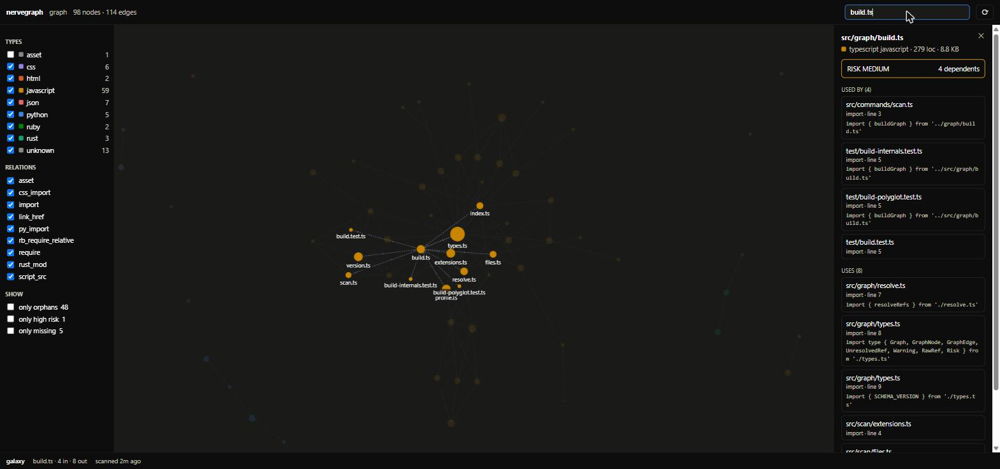

# nervegraph

[](https://www.npmjs.com/package/nervegraph)
[](https://humanloads.dev/nervegraph)
[](https://github.com/ZenyaDAR/nervegraph/actions/workflows/test.yml)
[](https://nodejs.org)
[](LICENSE)

> Obsidian Graph View, but for source code.
> One command scans the project, another opens an interactive relationship map in the browser.
>
> Liquid · JavaScript · TypeScript · Vue/Svelte/Astro · HTML · CSS · Python · Ruby ·
> Rust · Go · PHP · Java/Kotlin · C/C++ · Markdown · Shell · Terraform

```bash
npx nervegraph@latest scan     # → .nervegraph/graph.json
npx nervegraph@latest view     # → http://localhost:4210
```



*nervegraph scanning its own repo. Selecting `src/graph/build.ts` shows its 4
dependents and 8 dependencies, each with the exact import line.*

---

## Install

Nothing to install — `npx` runs it straight from npm:

```bash
npx nervegraph@latest scan
npx nervegraph@latest view
```

Keep the `@latest`: without it, `npx` runs a copy installed in the project or
globally, however old. Offline, use `npx --offline nervegraph` (runs the cached copy).

Or install it properly, which pins the version until you update it:

```bash
npm install -g nervegraph     # global, gives you the `nerve` binary
nerve scan
nerve view
```

```bash
npm install -D nervegraph     # per-project
npx nerve scan
```

Requires **Node ≥ 22.6**.

---

## Usage

```bash
nerve scan  [path] [flags]    # writes .nervegraph/graph.json
nerve view         [flags]    # serves the interactive map
nerve overview     [flags]    # how the project is laid out, in ~1 KB
nerve query <file> [flags]    # what uses this file, and what it uses
nerve check        [flags]    # fail the build when the graph breaks a budget
nerve diff <a> [b] [flags]    # what changed structurally between two graphs
nerve export       [flags]    # the graph as mermaid or dot text
nerve mcp          [flags]    # serve the graph to an agent over MCP (stdio)
nerve agents-md               # a snippet for CLAUDE.md / AGENTS.md
```

### `nerve scan`

| Flag | Default | What it does |
|---|---|---|
| `--profile <name>` | `auto` | `shopify`, `js`, `poly`, or `auto` detection |
| `--watch` | off | re-scan on change; an open viewer reloads itself |
| `--out <dir>` | `.nervegraph` | Where `graph.json` is written |
| `--ignore <glob>` | — | Extra ignore pattern; repeatable |
| `--no-gitignore` | off | Don't read `.gitignore` |
| `--classes` | off | Also collect CSS/HTML class names (noisy) |
| `--pretty` | off | Indent `graph.json` — bigger, but diffable by hand |
| `--json` | off | Machine-readable summary on stdout |
| `--quiet` | off | Suppress the report |

`.gitignore` and `.nervegraphignore` are respected by default, and
`node_modules`, `dist`, `build`, `vendor`, `coverage` and minified files are
always skipped.

### `nerve view`

| Flag | Default | What it does |
|---|---|---|
| `--port <n>` | `4210` | Port to serve on (probes upward if taken) |
| `--graph <path>` | `.nervegraph/graph.json` | Which graph to open |
| `--no-open` | off | Don't launch a browser |

In the viewer: click a node for its dependents and dependencies, `/` or
`Ctrl+K` to search, and use the sidebar to filter by language, relation type,
or to isolate orphans, high-risk files and broken links. `?` shows the rest —
colour and size modes, the issues panel (`i`), shift-click to trace the path
between two files, and the focus controls.

### `nerve query`

| Flag | Default | What it does |
|---|---|---|
| `--json` | off | The card as JSON and nothing else — one line, pipe-safe |
| `--pretty` | off | Indent the JSON |
| `--limit <n>` | `50` | Entries per list; `0` = all. Dropped counts go under `truncated` |
| `--raw` | off | Include the source text of each reference |
| `--depth <n>` | — | Also list files within n hops |
| `--direction <d>` | `both` | `in` (dependents) or `out` (dependencies) for `--depth` |
| `--transitive` | off | List every transitive dependent, not just the count |
| `--symbol <name>` | — | Where an export is defined, and every `file:line` importing it |
| `--changed` | off | Files changed in git, their dependents, and the tests to run |
| `--base <ref>` | — | With `--changed`: also changes since this ref |
| `--orphans` | off | List unreferenced code files (`--all` adds tests, fixtures, docs, config) |
| `--fields <a,b>` | — | List modes: keep only these row fields |
| `--missing` | off | List referenced files that aren't on disk |
| `--unresolved` | off | List references static analysis couldn't follow (`--all` adds external packages and URLs) |
| `--risk <level>` | — | List files at `low`, `medium` or `high` risk |
| `--dead-exports` | off | List exports nothing imports |
| `--duplicates` | off | List groups of byte-identical files |
| `--cycles` | off | List dependency cycles |
| `--packages` | off | Fold the graph up to one node per package (monorepos) |
| `--graph <path>` | nearest `.nervegraph/graph.json` | Which graph to read |
| `--no-autoscan` | off | Don't scan a missing graph or re-scan a stale one |

```
$ nerve query src/graph/types.ts
src/graph/types.ts
  typescript javascript · 146 loc · risk high
  34 dependents (50 transitive) · 0 dependencies
```

In `--json`, `usedBy` and `uses` hold one entry per file —
`{ file, rel, lines, names }` — and `tests` lists the test files that reach the
file, however indirectly: what to run after editing it.

### `nerve check`

The same artifact as a gate. Nothing fails unless you ask for it, except a
reference to a file that isn't on disk:

```bash
nerve scan --quiet && nerve check --max-cycles 0 --no-duplicates
# exit code 7 when a budget is broken, 0 when every budget is met
```

| Flag | What it means |
|---|---|
| `--max-cycles <n>` | At most n dependency cycles |
| `--max-unresolved <n>` | At most n references static analysis couldn't follow |
| `--max-orphans <n>` | At most n files nothing references |
| `--allow-missing` | Tolerate references to files that aren't on disk |
| `--no-dead-exports` | Fail if any export is unused |
| `--no-duplicates` | Fail if any two files are byte-identical |
| `--rules <file>` | Layer rules; `.nervegraph/rules.json` is picked up automatically |

Layer rules are yours to write — the tool only checks what you declared:

```json
[
  { "name": "ui must not reach the database", "from": "src/ui/**", "deny": "src/db/**" },
  { "from": "src/core/**", "allow": "src/core/**" }
]
```

### `nerve diff` and `nerve export`

```bash
nerve diff                                 # what the last re-scan changed (scan keeps graph.prev.json)
nerve diff old-graph.json                  # against .nervegraph/graph.json
nerve export --format mermaid --focus src/graph/build.ts --depth 1
nerve export --format dot --out graph.dot
```

`diff` names new and removed files and edges, cycles introduced or resolved,
files that became orphans, and files whose risk went up — the structural half
of a code review. `export` writes the map as text, so a diagram can live in a
README or an ADR and be diffed like code.

### Typical run

```bash
cd some-project
npx nervegraph@latest scan          # 98 files · 114 edges
npx nervegraph@latest view          # → http://localhost:4210
```

### For AI agents

The MCP server is the way in — an agent finds it on its own and calls it
before it reaches for grep:

```json
{ "mcpServers": { "nervegraph": { "command": "npx", "args": ["-y", "nervegraph@latest", "mcp"] } } }
```

Five read-only tools: `nervegraph_query` (what a change to one file
affects), `nervegraph_overview` (start here), `nervegraph_symbol` (one
export), `nervegraph_changed` (git changes, their dependents and tests) and
`nervegraph_list` (orphans, missing, unresolved, risk, unused exports,
duplicates, cycles, packages). The server sends instructions on when to use
them and keeps `nervegraph_query` loaded with the session.

The same answers from the shell — one-line JSON, a few kilobytes each:

```bash
nerve overview --json                     # 1. layout, entrypoints, hubs, issue counts
nerve query src/graph/io.ts --json        # 2. before an edit: what it affects, tests, risk
nerve query --symbol readGraph --json     # 3. before a rename: every import site
nerve query --changed --json              # 4. after edits: dependents and tests to run
```

In a card, `usedBy` lists the direct dependents with lines and imported names,
`indirectDependents` every other file that reaches it, grouped by type
(`section`, `template_json`, `javascript`, …), `affectedByType` counts all of
them, and `tests` the test files that reach it. Lists are capped at `--limit`
(default 50, per type for `indirectDependents`) with the dropped counts under
`truncated`. A wrong file name answers with the closest matches; a directory
with its files.

No need to scan first: every command finds the nearest
`.nervegraph/graph.json` (up to the repository root), scans when there is
none, and re-scans when a file changed since — `--no-autoscan` turns that off.
If you commit `.nervegraph/`, commit `graph.json` only: `graph.prev.json` and
`walked` are the tool's local state.
Don't read `graph.json` itself; on a real repo it is tens of thousands of
tokens. `nerve agents-md >> CLAUDE.md` writes a short note for agents that use
the shell.

How much this helps an agent, measured: [With and without nervegraph](#with-and-without-nervegraph).

---

## With and without nervegraph

An agent can answer "what does this change affect" on its own, with grep and
file reads. The question is whether the graph makes it more correct or
cheaper, and whether an agent uses the graph at all when it is connected.
We ran the same tasks three ways and checked every answer.

### How it was measured

- **Project:** [Shopify Horizon](https://github.com/Shopify/horizon) (`main`,
  2026-11-25), 511 files. It is public, and modern themes are where most links
  are not plain imports: `@theme/*` import maps, ``, theme blocks
  named in ``, custom elements, sections fetched by the Section
  Rendering API.
- **Agent:** Claude Code 2.1.332, headless (`claude -p --model sonnet`). No
  user settings, hooks, memory, skills or other MCP servers. Read-only tools:
  `Read`, `Grep`, `Glob` (no shell), plus the nervegraph MCP server where noted.
- **Setups:**
  - **A, without nervegraph:** built-in tools only.
  - **B, previous build connected:** the MCP server as it was before the
    agent-facing changes in this release, with and without the `agents-md`
    snippet in `CLAUDE.md`.
  - **C, this build connected:** the same, with this release.
- **Reference answers** came from a separate script that reads the theme
  sources, not from nervegraph. It missed one real chain, which was found by
  comparing answers and confirmed by hand. The reference was corrected for
  every setup alike.
- **Runs:** 2 per task and setup (task 3 in setup A: 1). Recall is the share of
  the reference files an answer named; no answer named a wrong file.

### Did the agent use the graph?

| Setup | Runs where the agent called nervegraph |
|---|---|
| B, previous build | **0 of 7** without the snippet, **1 of 4** with it |
| C, this build | **16 of 16** (8 with the snippet, 8 without) |

With the previous build the server was connected and its tools were listed,
yet the agent searched with `Grep` anyway. The tool descriptions listed fields
("usedBy, uses, risk…") and did not say which question they answer or when to
prefer them over grep. Claude Code also loads MCP tools on demand, behind a
tool search, so an unclear description is never loaded. In the one run that
did call it, the answer was a count (`transitiveDependents: 67`) and one mixed
list, so the agent re-checked it with grep.

### Results, A (without) vs C (with)

| Task | Setup | Found | Turns | Input tokens | Time | Cost |
|---|---|---|---|---|---|---|
| 1. Which `sections/` and `templates/` files can a change to `snippets/product-media.liquid` affect, through any chain? (16 files) | A | **88%** (14 of 16) | 7–9 | 109k | 27 s | $0.117 |
| | C | **100%** | 2 | 26k | 8 s | $0.051 |
| 2. Which JS files can a change to `assets/utilities.js` affect, through any chain of imports? (67 files) | A | 100% | 4 | 53k | 20 s | $0.098 |
| | C | 100% | 2 | 33k | 12 s | $0.078 |
| 3. Which files import the export `requestIdleCallback` by name? (6 files) | A | 100% | 3 | 25k | 8 s | $0.047 |
| | C | 100% | 5–6 | 47k | 13 s | $0.058 |
| 4. Which JS files import `assets/component.js` directly? (56 files) | A | 100% | 2–3 | 13k | 7 s | $0.020 |
| | C | 100% | 3 | 34k | 11 s | $0.088 |

Setup B matched setup A on every task (it never used the graph), at the cost
of the extra tool definitions: task 1 took 10–13 turns and 143k tokens.

**What the numbers say:**

- **Chains across file types (task 1): more correct, 4× fewer tokens, less
  than half the cost.** Grepping
  hop by hop, from the snippet to the snippets that render it, the blocks and
  sections, then the templates, the agent missed two sections in every run:
  - `sections/carousel.liquid` reaches the snippet through theme blocks named
    in its ``, not through a tag in its markup;
  - `sections/product-hotspots.liquid` reaches it through a custom element
    defined in `assets/quick-add.js`, which fetches a section with the Section
    Rendering API.

  The graph answered in one call. Its `indirectDependents` are grouped by
  type, so the agent read off `section` and `template_json`.
- **Chains of imports (task 2): same answer, 38% fewer tokens, 40% less
  time.** A JS import chain is uniform enough for grep, but it still takes a
  search per level.
- **One-hop questions (tasks 3 and 4): grep is cheaper.** One search answers
  them. With the graph connected the agent called it, then grepped to confirm,
  so it paid for both. Use grep for these.

### What changed between B and C

All changes are in how the tool presents itself and what it returns. The
graph is the same.

- **MCP server instructions** say when to prefer the graph over grep, and what
  it cannot see (string-built paths, events, globals).
- **Tool descriptions** start with the question they answer ("What breaks if I
  change, move or delete this file?").
- **`nervegraph_query` is loaded with the session** (`anthropic/alwaysLoad`)
  instead of behind a tool search. Without that, the agent still found it for
  tasks 1 and 2, with one extra turn and 12k more tokens.
- **The card answers instead of pointing:** `indirectDependents` grouped by
  type (each type capped on its own, so 50 blocks cannot hide the JS modules),
  and `affectedByType` counts.
- **Fewer steps:**
  - no "run `nerve scan` first": a missing or stale graph is scanned before
    the call;
  - a wrong file name returns the closest matches;
  - every tool is marked read-only, so the client may run calls in parallel.

### Limits of this measurement

- **Small sample:** one theme, one model, two runs per cell. Read it as
  direction and rough size, not a benchmark.
- **One kind of project:** a Shopify theme is the case nervegraph covers best.
  On a plain TypeScript project, where grep follows imports well, expect a
  smaller difference.
- **Token counts include cached input,** which costs less than fresh input.
  The cost column is what the CLI reported.
- **Not measured:** editing tasks (whether the change ends up correct) and
  agents other than Claude Code.

---

## Languages

| Language | Extensions | What becomes an edge |
|---|---|---|
| Liquid | `.liquid` | `render`, `include`, `section`, `sections`, `content_for`, `asset_url`, `inline_asset_content`, `t`, `` theme blocks, inline `<script>` imports |
| JavaScript / TypeScript | `.js` `.mjs` `.cjs` `.jsx` `.ts` `.tsx` `.mts` `.cts` | `import`, `export … from`, `import()`, `require()`, through tsconfig/jsconfig paths and import maps |
| HTML | `.html` `.htm` | `<script src>`, `<link href>`, ``/`<source>`/`<iframe>`/… `src` |
| CSS | `.css` `.scss` `.sass` `.less` | `@import`, `@use`, `url()` |
| Python | `.py` `.pyi` | `import x`, `from x import y`, relative `from .x import y` |
| Ruby | `.rb` `.rake` `.gemspec` | `require`, `require_relative` |
| Rust | `.rs` | `mod x;` (the declarations that pull files into the crate) |
| Vue / Svelte / Astro | `.vue` `.svelte` `.astro` | the `<script>` imports, `<style>` `@use`/`url()`, and template `src` attributes |
| Go | `.go` | `import "…"` inside the repo's own module (from `go.mod`) |
| PHP | `.php` `.phtml` | `require`/`include`, and `use` through composer's PSR-4 map |
| Java / Kotlin | `.java` `.kt` `.kts` | `import a.b.C` under the Maven/Gradle source root |
| C / C++ | `.c` `.h` `.cc` `.cpp` `.hpp` … | `#include "x.h"` (angle-bracket includes are external) |
| Markdown | `.md` `.mdx` | links and images pointing at project files |
| Shell | `.sh` `.bash` `.zsh` | `source x.sh` / `. x.sh` |
| Terraform | `.tf` `.tfvars` | `module { source = "./…" }` |
| Shopify JSON | `templates/*.json`, `sections/*.json` | `sections.*.type`, theme blocks in `blocks.*.type` |
| Section Rendering API | theme JS and Liquid | `section_id=x`, `'section_id', 'x'`, `data-section-id="x"`, `sections=a,b` |
| Web components | any markup + JS | `<product-form>` ↔ `customElements.define('product-form', …)` |

### Maturity

Breadth without measured accuracy is how a dependency graph quietly starts
lying, so each language carries a label rather than an implied promise:

| Level | Languages | What it means |
|---|---|---|
| verified | Liquid, JavaScript / TypeScript, HTML, CSS, Shopify JSON | Exercised against real projects; scanner and resolver both covered by tests |
| experimental | Python, Ruby, Rust, Go, PHP, Java / Kotlin, C / C++, Vue / Svelte / Astro, Markdown, Shell, Terraform | Covered by unit tests on fixtures, not yet measured on a large real codebase — expect gaps rather than wrong edges |

A language moves to *verified* when its `unresolved` share has been measured on
a real repository, not before.

Third-party references stay out of the graph: `import requests`, `require
'json'` and a CDN `<script src>` are reported as **external**, not as broken
links. A reference that *must* be a project file — a relative Python import, a
`require_relative`, a `mod` declaration — and isn't there becomes a **missing**
node, which is the point: that's a broken link in production.

### Known gaps

Deliberate, and cheaper to state than to hide:

- **Rust `use` paths are not followed.** `mod` declarations already define the
  file graph; `use` is item-level and would need full name resolution for zero
  extra nodes.
- **Rails autoloading is invisible.** Zeitwerk resolves `User` →
  `app/models/user.rb` with no `require`, so a Rails app's graph is thinner
  than its real coupling.
- **Python docstrings can produce a phantom import** if a line inside one
  starts with `import x`.
- **ERB `<%= %>` inside an HTML attribute is skipped**, because the `>` in `%>`
  ends the tag match. `.html.erb` isn't a scanned extension.
- **A Go import resolves to one file of the package**, not to all of them —
  the package's own `<name>.go` if it exists, otherwise its first source. Nodes
  are files, and a package is a directory.
- **Java's same-package references are invisible**, because they need no
  `import`; only cross-package coupling shows up.
- **`import a.b.*` and `use App\{A, B}` are skipped** rather than expanded to
  an arbitrary member of the package.
- **A theme's import maps are merged into one**, `scopes` included; maps that
  disagree are not told apart. An HTML page's map applies to its own directory.
- **`@theme` in a schema is not expanded.** A block only ever placed through
  `"type": "@theme"`, and named by no file, is listed as an orphan.

---

## Why

Open someone else's 60,000-line theme and understand its architecture in 10 seconds.
See who uses a file before deleting it. See what breaks before editing a snippet.

A useful side effect: the graph is queryable, so an AI agent (Claude Code, Cursor)
can ask it what a file touches instead of grepping the whole repo.

---

## Key decisions (locked in)

| Question | Decision | Why |
|--------|---------|-----|
| Package name | `nervegraph`, binary `nerve` | Checked for availability on npm before publishing |
| Runtime | Node ≥ 22.6, TypeScript, ESM | Needs `--experimental-strip-types` to run TS sources directly |
| Argument parser | `node:util` → `parseArgs` | Stdlib, commander not needed |
| HTTP server | `node:http` | 3 static files, express not needed |
| Liquid / HTML | Regex over tags, not a full AST | Reference tags are trivially regular |
| JS | `es-module-lexer` + regex for `require` | A full Babel AST is overkill for v0.1 |
| CSS | `postcss` | Correctly extracts `@import` and selectors |
| Python, Ruby, Rust, Go, PHP, Java/Kotlin, C/C++, Markdown, Shell, Terraform | Line-oriented regex, zero dependencies | Import syntax in all of them is regular; a per-language parser would be one more dependency each for the same edges |
| Vue / Svelte / Astro | Split the file, reuse the HTML, JS and style passes | A SFC is three languages in one file, and all three scanners already exist |
| Visualization | `force-graph` (vasturiano), canvas | Drag, zoom, highlight, 5k+ nodes out of the box |
| Frontend framework | None. Vanilla JS + one HTML file | The detail panel is 150 lines of DOM |
| Storage | A single `graph.json` | SQLite at 100k+ nodes, not before |

