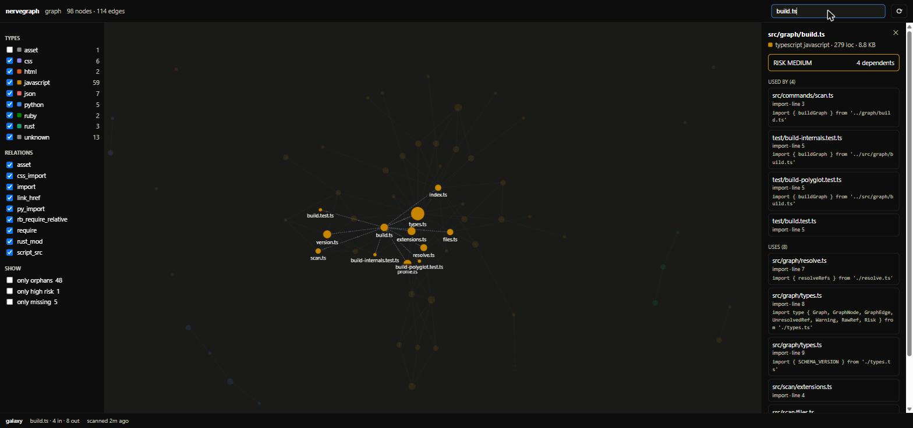

# nervegraph

> Obsidian Graph View, but for source code.
> One command scans the project, another opens an interactive relationship map in the browser.
>
> Liquid · JavaScript · TypeScript · Vue/Svelte/Astro · HTML · CSS · Python · Ruby ·
> Rust · Go · PHP · Java/Kotlin · C/C++ · Markdown · Shell · Terraform

```bash
npx nervegraph scan     # → .nervegraph/graph.json
npx nervegraph view     # → http://localhost:4210
```



*nervegraph scanning its own repo. Selecting `src/graph/build.ts` shows its 4
dependents and 8 dependencies, each with the exact import line.*

---

## Install

Nothing to install — `npx` runs it straight from npm:

```bash
npx nervegraph scan
npx nervegraph view
```

Or install it properly:

```bash
npm install -g nervegraph     # global, gives you the `nerve` binary
nerve scan
nerve view
```

```bash
npm install -D nervegraph     # per-project
npx nerve scan
```

Requires **Node ≥ 22.6**.

---

## Usage

```bash
nerve scan  [path] [flags]    # writes .nervegraph/graph.json
nerve view         [flags]    # serves the interactive map
nerve query <file> [flags]    # what uses this file, and what it uses
nerve check        [flags]    # fail the build when the graph breaks a budget
nerve diff <a> [b] [flags]    # what changed structurally between two graphs
nerve export       [flags]    # the graph as mermaid or dot text
nerve mcp          [flags]    # serve the graph to an agent over MCP (stdio)
```

### `nerve scan`

| Flag | Default | What it does |
|---|---|---|
| `--profile <name>` | `auto` | `shopify`, `js`, `poly`, or `auto` detection |
| `--watch` | off | re-scan on change; an open viewer reloads itself |
| `--out <dir>` | `.nervegraph` | Where `graph.json` is written |
| `--ignore <glob>` | — | Extra ignore pattern; repeatable |
| `--no-gitignore` | off | Don't read `.gitignore` |
| `--classes` | off | Also collect CSS/HTML class names (noisy) |
| `--pretty` | off | Indent `graph.json` — bigger, but diffable by hand |
| `--json` | off | Machine-readable summary on stdout |
| `--quiet` | off | Suppress the report |

`.gitignore` and `.nervegraphignore` are respected by default, and
`node_modules`, `dist`, `build`, `vendor`, `coverage` and minified files are
always skipped.

### `nerve view`

| Flag | Default | What it does |
|---|---|---|
| `--port <n>` | `4210` | Port to serve on (probes upward if taken) |
| `--graph <path>` | `.nervegraph/graph.json` | Which graph to open |
| `--no-open` | off | Don't launch a browser |

In the viewer: click a node for its dependents and dependencies, `/` or
`Ctrl+K` to search, and use the sidebar to filter by language, relation type,
or to isolate orphans, high-risk files and broken links. `?` shows the rest —
colour and size modes, the issues panel (`i`), shift-click to trace the path
between two files, and the focus controls.

### `nerve query`

| Flag | Default | What it does |
|---|---|---|
| `--json` | off | The card as JSON and nothing else — pipe-safe |
| `--depth <n>` | — | Also list files within n hops |
| `--orphans` | off | List every file nothing references |
| `--missing` | off | List referenced files that aren't on disk |
| `--unresolved` | off | List references static analysis couldn't follow |
| `--risk <level>` | — | List files at `low`, `medium` or `high` risk |
| `--dead-exports` | off | List exports nothing imports |
| `--duplicates` | off | List groups of byte-identical files |
| `--cycles` | off | List dependency cycles |
| `--packages` | off | Fold the graph up to one node per package (monorepos) |
| `--graph <path>` | `.nervegraph/graph.json` | Which graph to read |

```
$ nerve query src/graph/types.ts
src/graph/types.ts
  typescript javascript · 122 loc · risk high
  34 dependents (50 transitive) · 0 dependencies
```

### `nerve check`

The same artifact as a gate. Nothing fails unless you ask for it, except a
reference to a file that isn't on disk:

```bash
nerve scan --quiet && nerve check --max-cycles 0 --no-duplicates
# exit code 7 when a budget is broken, 0 when every budget is met
```

| Flag | What it means |
|---|---|
| `--max-cycles <n>` | At most n dependency cycles |
| `--max-unresolved <n>` | At most n references static analysis couldn't follow |
| `--max-orphans <n>` | At most n files nothing references |
| `--allow-missing` | Tolerate references to files that aren't on disk |
| `--no-dead-exports` | Fail if any export is unused |
| `--no-duplicates` | Fail if any two files are byte-identical |
| `--rules <file>` | Layer rules; `.nervegraph/rules.json` is picked up automatically |

Layer rules are yours to write — the tool only checks what you declared:

```json
[
  { "name": "ui must not reach the database", "from": "src/ui/**", "deny": "src/db/**" },
  { "from": "src/core/**", "allow": "src/core/**" }
]
```

### `nerve diff` and `nerve export`

```bash
nerve diff old-graph.json                  # against .nervegraph/graph.json
nerve export --format mermaid --focus src/graph/build.ts --depth 1
nerve export --format dot --out graph.dot
```

`diff` names new and removed files and edges, cycles introduced or resolved,
files that became orphans, and files whose risk went up — the structural half
of a code review. `export` writes the map as text, so a diagram can live in a
README or an ADR and be diffed like code.

### Typical run

```bash
cd some-project
npx nervegraph scan          # 98 files · 114 edges
npx nervegraph view          # → http://localhost:4210
```

### For AI agents

`graph.json` is plain, sorted, deterministic JSON, so an agent (Claude Code,
Cursor) can read the dependency map instead of grepping the whole repo:

```bash
nerve query snippets/product-card.liquid --json
```

`usedBy` lists what breaks if the file changes, `transitiveDependents` is the
full blast radius, and `stale: true` means the file changed since the scan —
run `nerve scan` first. The whole map is also readable directly:

```bash
nerve scan --quiet && cat .nervegraph/graph.json
```

Keep it fresh while working: `nerve scan --watch` in one terminal, `nerve view`
in another — the map reloads itself on every re-scan.

Agents that speak MCP can skip the shell entirely:

```json
{ "mcpServers": { "nervegraph": { "command": "npx", "args": ["nervegraph", "mcp"] } } }
```

It exposes two tools — `nervegraph_query` (one file's dependents, dependencies,
risk and blast radius) and `nervegraph_list` (orphans, missing files, high-risk
files, unused exports, duplicates, cycles). The graph is re-read on every call,
so `nerve scan --watch` keeps the agent current.

---

## Languages

| Language | Extensions | What becomes an edge |
|---|---|---|
| Liquid | `.liquid` | `render`, `include`, `section`, `sections`, `content_for`, `asset_url`, `t` |
| JavaScript / TypeScript | `.js` `.mjs` `.cjs` `.jsx` `.ts` `.tsx` `.mts` `.cts` | `import`, `export … from`, `import()`, `require()` |
| HTML | `.html` `.htm` | `<script src>`, `<link href>`, ``/`<source>`/`<iframe>`/… `src` |
| CSS | `.css` `.scss` `.sass` `.less` | `@import`, `@use`, `url()` |
| Python | `.py` `.pyi` | `import x`, `from x import y`, relative `from .x import y` |
| Ruby | `.rb` `.rake` `.gemspec` | `require`, `require_relative` |
| Rust | `.rs` | `mod x;` (the declarations that pull files into the crate) |
| Vue / Svelte / Astro | `.vue` `.svelte` `.astro` | the `<script>` imports, `<style>` `@use`/`url()`, and template `src` attributes |
| Go | `.go` | `import "…"` inside the repo's own module (from `go.mod`) |
| PHP | `.php` `.phtml` | `require`/`include`, and `use` through composer's PSR-4 map |
| Java / Kotlin | `.java` `.kt` `.kts` | `import a.b.C` under the Maven/Gradle source root |
| C / C++ | `.c` `.h` `.cc` `.cpp` `.hpp` … | `#include "x.h"` (angle-bracket includes are external) |
| Markdown | `.md` `.mdx` | links and images pointing at project files |
| Shell | `.sh` `.bash` `.zsh` | `source x.sh` / `. x.sh` |
| Terraform | `.tf` `.tfvars` | `module { source = "./…" }` |
| Shopify JSON | `templates/*.json`, `sections/*.json` | `sections.*.type` |
| Web components | any markup + JS | `<product-form>` ↔ `customElements.define('product-form', …)` |

### Maturity

Breadth without measured accuracy is how a dependency graph quietly starts
lying, so each language carries a label rather than an implied promise:

| Level | Languages | What it means |
|---|---|---|
| verified | Liquid, JavaScript / TypeScript, HTML, CSS, Shopify JSON | Exercised against real projects; scanner and resolver both covered by tests |
| experimental | Python, Ruby, Rust, Go, PHP, Java / Kotlin, C / C++, Vue / Svelte / Astro, Markdown, Shell, Terraform | Covered by unit tests on fixtures, not yet measured on a large real codebase — expect gaps rather than wrong edges |

A language moves to *verified* when its `unresolved` share has been measured on
a real repository, not before.

Third-party references stay out of the graph: `import requests`, `require
'json'` and a CDN `<script src>` are reported as **external**, not as broken
links. A reference that *must* be a project file — a relative Python import, a
`require_relative`, a `mod` declaration — and isn't there becomes a **missing**
node, which is the point: that's a broken link in production.

### Known gaps

Deliberate, and cheaper to state than to hide:

- **Rust `use` paths are not followed.** `mod` declarations already define the
  file graph; `use` is item-level and would need full name resolution for zero
  extra nodes.
- **Rails autoloading is invisible.** Zeitwerk resolves `User` →
  `app/models/user.rb` with no `require`, so a Rails app's graph is thinner
  than its real coupling.
- **Python docstrings can produce a phantom import** if a line inside one
  starts with `import x`.
- **ERB `<%= %>` inside an HTML attribute is skipped**, because the `>` in `%>`
  ends the tag match. `.html.erb` isn't a scanned extension.
- **A Go import resolves to one file of the package**, not to all of them —
  the package's own `<name>.go` if it exists, otherwise its first source. Nodes
  are files, and a package is a directory.
- **Java's same-package references are invisible**, because they need no
  `import`; only cross-package coupling shows up.
- **`import a.b.*` and `use App\{A, B}` are skipped** rather than expanded to
  an arbitrary member of the package.
- **Aliases are resolved from a single root config.** `tsconfig.json`
  `extends` chains and per-package tsconfigs in a monorepo are not followed;
  workspace package names are.

---

## Why

Open someone else's 60,000-line theme and understand its architecture in 10 seconds.
See who uses a file before deleting it. See what breaks before editing a snippet.

A useful side effect: `graph.json` is machine-readable, so an AI agent (Claude Code, Cursor)
can read the map instead of grepping the whole repo.

---

## Key decisions (locked in)

| Question | Decision | Why |
|--------|---------|-----|
| Package name | `nervegraph`, binary `nerve` | Checked for availability on npm before publishing |
| Runtime | Node ≥ 22.6, TypeScript, ESM | Needs `--experimental-strip-types` to run TS sources directly |
| Argument parser | `node:util` → `parseArgs` | Stdlib, commander not needed |
| HTTP server | `node:http` | 3 static files, express not needed |
| Liquid / HTML | Regex over tags, not a full AST | Reference tags are trivially regular |
| JS | `es-module-lexer` + regex for `require` | A full Babel AST is overkill for v0.1 |
| CSS | `postcss` | Correctly extracts `@import` and selectors |
| Python, Ruby, Rust, Go, PHP, Java/Kotlin, C/C++, Markdown, Shell, Terraform | Line-oriented regex, zero dependencies | Import syntax in all of them is regular; a per-language parser would be one more dependency each for the same edges |
| Vue / Svelte / Astro | Split the file, reuse the HTML, JS and style passes | A SFC is three languages in one file, and all three scanners already exist |
| Visualization | `force-graph` (vasturiano), canvas | Drag, zoom, highlight, 5k+ nodes out of the box |
| Frontend framework | None. Vanilla JS + one HTML file | The detail panel is 150 lines of DOM |
| Storage | A single `graph.json` | SQLite at 100k+ nodes, not before |

